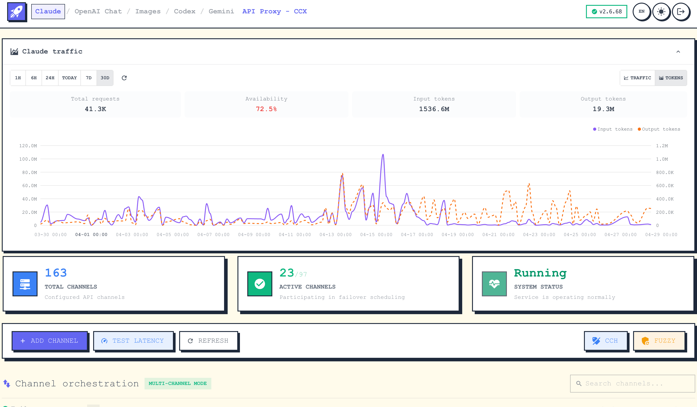
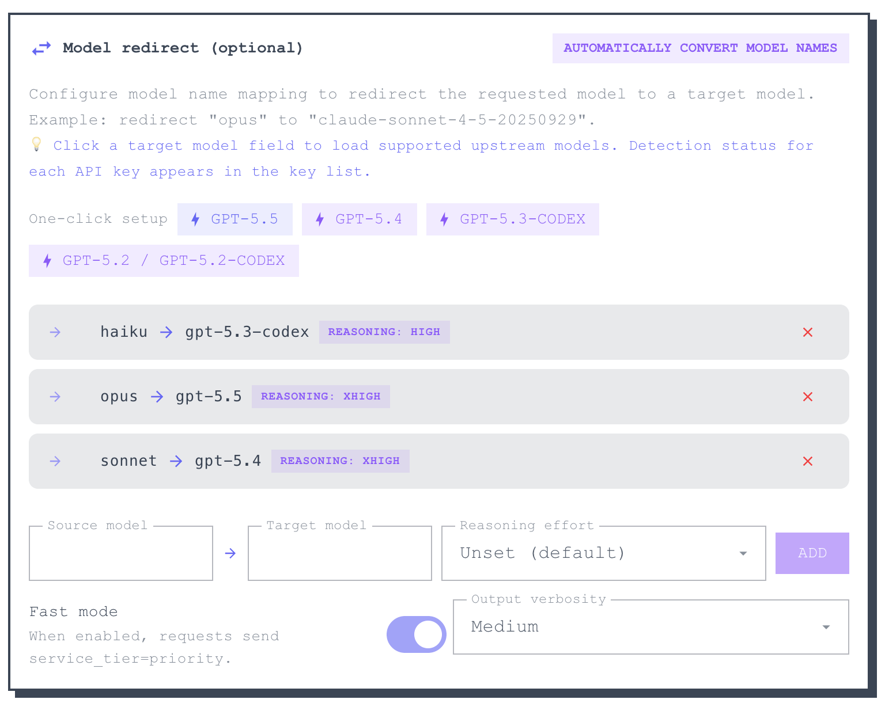
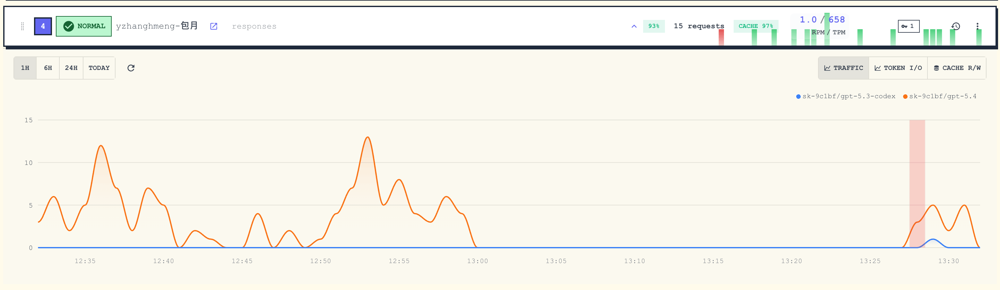

# 云起 Yunqi — 连接客户端与模型。

**多模型 API 网关与协议转换服务**

English | [简体中文](README.zh-CN.md)

[](https://github.com/soulteary/yunqi/releases/latest)
[](LICENSE)

Yunqi is a high-performance AI API proxy and protocol translation gateway for Claude, OpenAI Chat, OpenAI Images, OpenAI Embeddings, Codex Responses, and Gemini. It provides a unified entrypoint, built-in web administration, channel orchestration, failover, multi-key management, and model routing.

> 本仓库发布资源尚未就绪时，请使用 `make build` 或 `docker compose up --build -d` 从源码构建。

## 名称与项目沿革

“云起”出自王维《终南别业》：“行到水穷处，坐看云起时。”项目源自 BenedictKing/ccx，名称不依附单一模型品牌。详见[项目沿革、更名与许可说明](docs/guide/project-origin.md)。

## Features

- Integrated backend + frontend architecture with single-port deployment
- Dual-key authentication with `PROXY_ACCESS_KEY` and optional `ADMIN_ACCESS_KEY`
- Web admin console for channel management, testing, logs, and monitoring
- Support for Claude Messages, OpenAI Chat Completions, OpenAI Images, OpenAI Embeddings, Codex Responses, and Gemini APIs
- Smart scheduling with priorities, promotion windows, health checks, failover, and circuit recovery
- Context routing filters candidate channels by actual model context window and max output capability
- Per-channel API key rotation, proxy support, custom headers, model allowlists, and route prefixes
- Responses session tracking for multi-turn workflows
- Embedded frontend assets for simple binary deployment


## Screenshots

### Channel Orchestration

Visual channel management with drag-and-drop priority adjustment and real-time health monitoring.



### Add Channel

Supports multiple upstream service types and flexible API key, model mapping, and request parameter configuration.



### Traffic Stats

Real-time monitoring of per-channel request traffic, success rate, and latency.



## Architecture

Yunqi exposes one backend entrypoint:

```text
Client -> backend :3000 ->
  |- /                            -> Web UI
  |- /api/*                       -> Admin API
  |- /v1/messages                 -> Claude Messages proxy
  |- /v1/chat/completions         -> OpenAI Chat proxy
  |- /v1/responses                -> Codex Responses proxy
  |- /v1/images/{...}             -> OpenAI Images proxy
  |- /v1/embeddings               -> OpenAI Embeddings proxy
  |- /v1/models                   -> Models API
  `- /v1beta/models/*             -> Gemini proxy
```

Images endpoints currently include:
- `POST /v1/images/generations`
- `POST /v1/images/edits`
- `POST /v1/images/variations`

See [ARCHITECTURE.md](docs/guide/architecture.md) for the detailed design.

## Quick Start

### Option 0: Yunqi Desktop

Yunqi Desktop provides a native desktop experience with GUI for managing channels, keys, and agent configuration.

| Platform | Install Method | Notes |
|----------|---------------|-------|
| **Windows** | Search **Yunqi Desktop** in [Microsoft Store](https://apps.microsoft.com/detail/yunqi-desktop) | Recommended. Auto-update, no manual signing. Also available as `setup.exe` from [GitHub Releases](https://github.com/soulteary/yunqi/releases/latest). |
| **macOS** | `brew tap BenedictKing/yunqi && brew install --cask yunqi-desktop` | Or download `.dmg` (arm64/amd64) from [GitHub Releases](https://github.com/soulteary/yunqi/releases/latest). |
| **Linux** | Download `.AppImage` from [GitHub Releases](https://github.com/soulteary/yunqi/releases/latest) | Mark as executable and run. |

See [Yunqi Desktop Guide](docs/en/guide/desktop/) for detailed setup instructions.

### Option 1: Binary

1. Download the latest binary from [Releases](https://github.com/soulteary/yunqi/releases/latest).
2. Create a `.env` file next to the binary:

```bash
PROXY_ACCESS_KEY=your-proxy-access-key
PORT=3688
ENABLE_WEB_UI=true
APP_UI_LANGUAGE=en
```

3. Run the binary and open `http://localhost:3000`

On Windows, if the client runs from cmd, PowerShell, WSL, or Docker and `localhost` does not reach Yunqi, use the Windows host IPv4 address instead, for example `http://192.168.1.23:3000`. When `BIND_HOST` is empty, Yunqi listens on all interfaces by default through `:PORT`; set `BIND_HOST=127.0.0.1` for local-only access.

For background startup without Docker, see [Service Startup](docs/service/README.md).

### Option 2: Docker

```bash
docker run -d \
  --name yunqi \
  -p 3000:3000 \
  -e PROXY_ACCESS_KEY=your-proxy-access-key \
  -e APP_UI_LANGUAGE=en \
  -v $(pwd)/.config:/app/.config \
  ghcr.io/soulteary/yunqi:latest
```

Run in the background with Docker Compose:

```bash
docker compose up -d
```

Enable Watchtower auto-update:

```bash
docker compose -f docker-compose.yml -f docker-compose.watchtower.yml up -d
```

Pull the latest image immediately after setup if needed:

```bash
docker compose pull yunqi
docker compose up -d yunqi
```

### Option 3: Build From Source

Prerequisites: [Go 1.25+](https://go.dev/dl/), [Bun](https://bun.sh), and Make (macOS: `xcode-select --install`).

```bash
git clone https://github.com/soulteary/yunqi
cd yunqi
cp backend-go/.env.example backend-go/.env
make install   # install all dependencies (frontend + Go modules + dev tools)
make run
```

Useful commands:

```bash
make dev
make run
make build
make frontend-dev
```

## Core Environment Variables

```bash
PORT=3688
ENV=production
ENABLE_WEB_UI=true
PROXY_ACCESS_KEY=your-proxy-access-key
ADMIN_ACCESS_KEY=your-admin-secret-key
APP_UI_LANGUAGE=en
LOG_LEVEL=info
```

## Main Endpoints

- Web UI: `GET /`
- Health: `GET /health`
- Admin API: `/api/*`
- Claude Messages: `POST /v1/messages`
- OpenAI Chat: `POST /v1/chat/completions`
- Codex Responses: `POST /v1/responses`
- OpenAI Images: `POST /v1/images/generations`, `POST /v1/images/edits`, `POST /v1/images/variations`
- OpenAI Embeddings: `POST /v1/embeddings`
- Gemini: `POST /v1beta/models/{model}:generateContent`
- Models API: `GET /v1/models`

## Development

Recommended local workflow:

```bash
make dev
```

Frontend only:

```bash
cd "frontend"
bun install
bun run dev
```

Backend only:

```bash
cd "backend-go"
make dev
```

## Additional Docs

- [Yunqi Desktop](docs/en/guide/desktop/)
- [Client Setup](docs/en/guide/clients/)
- [Yunqi Desktop (中文)](docs/guide/desktop/)
- [Client Setup (中文)](docs/guide/clients/)
- [README.zh-CN.md](README.zh-CN.md)
- [backend-go/README.md](backend-go/README.md)
- [ARCHITECTURE.md](docs/guide/architecture.md)
- [DEVELOPMENT.md](docs/guide/development.md)
- [ENVIRONMENT.md](docs/guide/environment.md)
- [docs/service/README.md](docs/service/README.md) - non-Docker service startup
- [RELEASE.md](docs/guide/release.md)


## Acknowledgments

<table>
  <tr>
    <td align="center" width="60">
      <strong>AA</strong>
    </td>
    <td>
      Benchmark data in this repository includes Artificial Analysis free API data. Attribution to <a href="https://artificialanalysis.ai/">artificialanalysis.ai</a> is required when using that data. Intelligence Index scores are currently interpreted against <strong>v4.1.1</strong>; Coding Index and Agentic Index are derived subsets of the same evaluation set and are not separately versioned.
    </td>
  </tr>
  <tr>
    <td align="center" width="60">
      <strong>Data</strong>
    </td>
    <td>
      Yunqi benchmark visualizations and registry updates also use publicly available data from <a href="https://benchlm.ai/">BenchLM.ai</a>, <a href="https://deepswe.datacurve.ai/">DeepSWE</a>, and <a href="https://deng.codexradar.com/">CodexRadar</a>. Pricing and context metadata are additionally refreshed from <a href="https://github.com/BerriAI/litellm/blob/main/model_prices_and_context_window.json">LiteLLM model_prices_and_context_window.json</a>.
    </td>
  </tr>
</table>

## License

AGPL-3.0-only。上游 MIT 许可与版权声明保留于 [LICENSES/MIT-upstream.txt](LICENSES/MIT-upstream.txt)，详见 [NOTICE](NOTICE)。