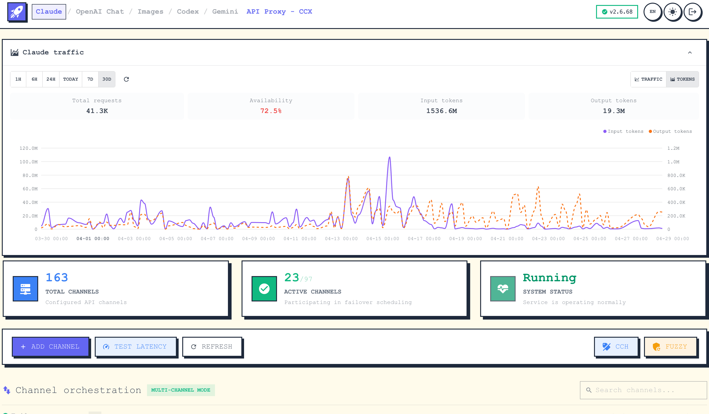
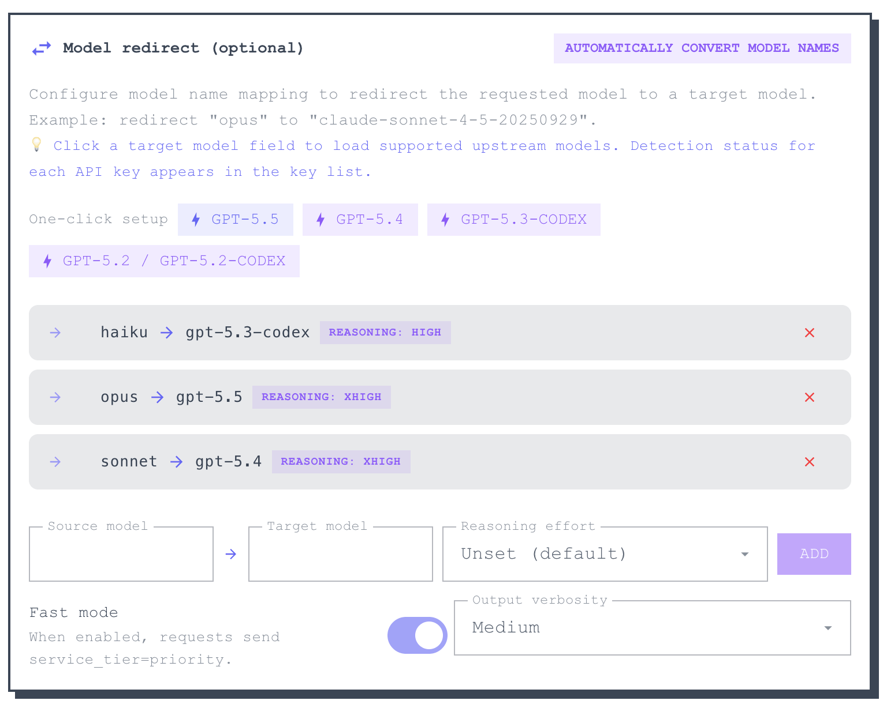
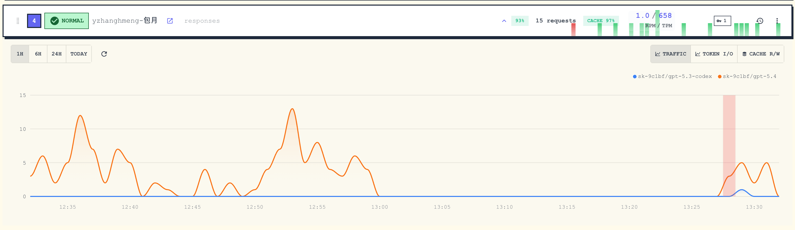

# 云起 Yunqi — 连接客户端与模型。

**多模型 API 网关与协议转换服务**

[English](README.md) | 简体中文

[](https://github.com/soulteary/yunqi/releases/latest)
[](LICENSE)

Yunqi 是一个高性能的 AI API 代理与协议转换网关，支持 Claude、OpenAI Chat、OpenAI Images、OpenAI Embeddings、Codex Responses 与 Gemini。它提供统一入口、内置 Web 管理界面、渠道编排、故障转移、多密钥管理和模型路由能力。

> 本仓库发布资源尚未就绪时，请使用 `make build` 或 `docker compose up --build -d` 从源码构建。

## 名称与项目沿革

“云起”出自王维《终南别业》：“行到水穷处，坐看云起时。”项目源自 BenedictKing/ccx，名称不依附单一模型品牌。详见[项目沿革、更名与许可说明](docs/guide/project-origin.md)。

## 功能特性

- 后端与前端一体化架构，单端口部署
- 双密钥认证：`PROXY_ACCESS_KEY` 与可选 `ADMIN_ACCESS_KEY`
- 内置 Web 管理面板，支持渠道管理、测试、日志和监控
- 同时支持 Claude Messages、OpenAI Chat Completions、OpenAI Images、OpenAI Embeddings、Codex Responses、Gemini
- 智能调度：优先级、促销期、健康检查、故障转移与熔断恢复
- 上下文路由：根据实际模型上下文窗口和最大输出能力过滤候选渠道
- 每个渠道支持多 API Key 轮换、代理、自定义请求头、模型白名单和路由前缀
- Responses API 支持多轮会话跟踪
- 前端构建产物嵌入后端，便于单二进制部署


## 界面预览

### 渠道编排

可视化渠道管理，支持拖拽调整优先级，实时查看渠道健康状态和调度统计。



### 添加渠道

支持多种上游服务类型，灵活配置 API 密钥、模型映射和请求参数。



### 流量统计

实时监控各渠道的请求流量、成功率和响应延迟。



## 架构概览

Yunqi 对外提供一个统一后端入口：

```text
客户端 -> backend :3000 ->
  |- /                            -> Web 管理界面
  |- /api/*                       -> 管理 API
  |- /v1/messages                 -> Claude Messages 代理
  |- /v1/chat/completions         -> OpenAI Chat 代理
  |- /v1/responses                -> Codex Responses 代理
  |- /v1/images/{...}             -> OpenAI Images 代理
  |- /v1/embeddings               -> OpenAI Embeddings 代理
  |- /v1/models                   -> Models API
  `- /v1beta/models/*             -> Gemini 代理
```

当前 Images 入口包括：
- `POST /v1/images/generations`
- `POST /v1/images/edits`
- `POST /v1/images/variations`

详细设计请参考 [ARCHITECTURE.md](docs/guide/architecture.md)。

## 快速开始

自动发布暂停期间，默认从源码构建。使用下载的二进制或镜像前，先检查[发布状态](docs/guide/release.md)及对应资源是否可用。

### 方式一：源码构建

前置依赖：[Go 1.26+](https://go.dev/dl/)、[Bun](https://bun.sh)、Make（macOS 需先执行 `xcode-select --install`）。

```bash
git clone https://github.com/soulteary/yunqi
cd yunqi
cp backend-go/.env.example backend-go/.env
make install
```

在 `backend-go/.env` 中设置自己的 `PROXY_ACCESS_KEY`，再执行 `make run`，访问其中配置的地址和端口。未设置独立 `ADMIN_ACCESS_KEY` 时，使用代理密钥登录管理界面。

### 方式二：构建本地 Docker 镜像

克隆仓库并替换 `docker-compose.yml` 中的示例代理密钥，然后执行：

```bash
docker compose up --build -d
```

仓库中的 Compose 文件会构建 `yunqi:local`，不依赖 GHCR 已发布镜像。

### 已发布的二进制与镜像

只有在 [Releases](https://github.com/soulteary/yunqi/releases) 或镜像仓库提供对应产物后，才使用以下方式。运行已发布的二进制时，在其同目录创建 `.env`：

```bash
PROXY_ACCESS_KEY=your-proxy-access-key
PORT=3688
ENABLE_WEB_UI=true
APP_UI_LANGUAGE=zh-CN
```

启动后访问 `http://localhost:3688`。使用已发布镜像时，将 `RELEASE_TAG` 替换为实际存在的标签：

```bash
docker run -d \
  --name yunqi \
  -p 3000:3000 \
  -e PROXY_ACCESS_KEY=your-proxy-access-key \
  -e APP_UI_LANGUAGE=zh-CN \
  -v "$(pwd)/.config:/app/.config" \
  ghcr.io/soulteary/yunqi:RELEASE_TAG
```

Windows 下若客户端环境无法通过 `localhost` 访问服务，可改用 Windows 主机的 IPv4 地址和实际端口。`BIND_HOST` 留空时监听所有网卡；仅允许本机访问时设置 `BIND_HOST=127.0.0.1`。后台运行或开机自启动见[服务启动说明](docs/service/README.md)。

常用命令：

```bash
make dev
make run
make build
make frontend-dev
```

## 主要环境变量

```bash
PORT=3688
ENV=production
ENABLE_WEB_UI=true
PROXY_ACCESS_KEY=your-proxy-access-key
ADMIN_ACCESS_KEY=your-admin-secret-key
APP_UI_LANGUAGE=zh-CN
LOG_LEVEL=info
```

## 主要接口

- Web UI：`GET /`
- 健康检查：`GET /health`
- 管理 API：`/api/*`
- Claude Messages：`POST /v1/messages`
- OpenAI Chat：`POST /v1/chat/completions`
- Codex Responses：`POST /v1/responses`
- OpenAI Images：`POST /v1/images/generations`、`POST /v1/images/edits`、`POST /v1/images/variations`
- OpenAI Embeddings：`POST /v1/embeddings`
- Gemini：`POST /v1beta/models/{model}:generateContent`
- 模型列表：`GET /v1/models`

## 开发

推荐本地开发方式：

```bash
make dev
```

仅前端：

```bash
cd "frontend"
bun install
bun run dev
```

仅后端：

```bash
cd "backend-go"
make dev
```

## 相关文档

- [Web 控制台与迁移指南](docs/guide/desktop)
- [客户端接入总览](docs/guide/clients)
- [README.md](README.md)
- [backend-go/README.md](backend-go/README.md)
- [ARCHITECTURE.md](docs/guide/architecture.md)
- [DEVELOPMENT.md](docs/guide/development.md)
- [ENVIRONMENT.md](docs/guide/environment.md)
- [docs/service/README.md](docs/service/README.md) - 非 Docker 自启动
- [RELEASE.md](docs/guide/release.md)


## 致谢

<table>
  <tr>
    <td align="center" width="60">
      <strong>AA</strong>
    </td>
    <td>
      本仓库中的部分 benchmark 数据使用了 Artificial Analysis 免费 API。凡使用这些数据，需按要求归因到 <a href="https://artificialanalysis.ai/">artificialanalysis.ai</a>。其中 Intelligence Index 当前应按 <strong>v4.1.1</strong> 解读；Coding Index 与 Agentic Index 是同一组评测子集的派生指标，不单独做版本管理。
    </td>
  </tr>
  <tr>
    <td align="center" width="60">
      <strong>数据源</strong>
    </td>
    <td>
      Yunqi 的 benchmark 可视化与注册表更新还使用了 <a href="https://benchlm.ai/">BenchLM.ai</a>、<a href="https://deepswe.datacurve.ai/">DeepSWE</a>、<a href="https://deng.codexradar.com/">CodexRadar</a> 的公开数据；价格与上下文窗口元数据另外同步自 <a href="https://github.com/BerriAI/litellm/blob/main/model_prices_and_context_window.json">LiteLLM model_prices_and_context_window.json</a>。
    </td>
  </tr>
</table>

## 许可证

AGPL-3.0-only。上游 MIT 许可与版权声明保留于 [LICENSES/MIT-upstream.txt](LICENSES/MIT-upstream.txt)，详见 [NOTICE](NOTICE)。

## Web console / Web 控制台

Yunqi 统一使用内嵌 Web 控制台的 Go 服务。在浏览器打开实际配置的端口，使用管理密钥登录，在「服务与接入」查看运行状态、导出诊断和生成客户端配置。服务二进制与 Docker 为维护中的部署方式，原桌面版迁移见 `docs/guide/desktop/index.md`。
